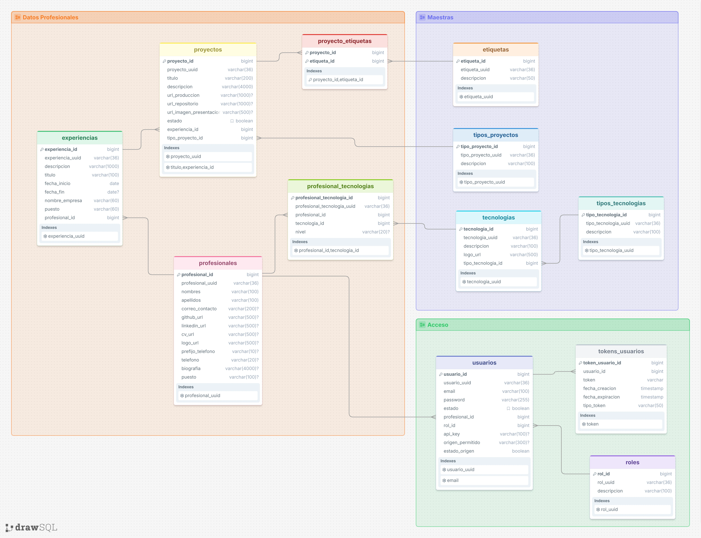

# DevVault API

Backend de **DevVault**, una plataforma headless que permite a profesionales gestionar su información y utilizarla en portafolios o aplicaciones externas mediante una API REST.

Centraliza perfiles profesionales, experiencias, proyectos y tecnologías, separando la administración del contenido de su presentación.

## Modelo relacional



## Funcionalidades

- Registro y autenticación de usuarios mediante JWT.
- Activación de cuenta por correo electrónico.
- Restricción de acceso según el estado de la cuenta.
- Gestión de información profesional, experiencias, proyectos y tecnologías.
- Consulta de información del portafolio mediante API Key.
- Generación de API Key.
- Configuración del origen permitido para las consultas.
- Limpieza programada de tokens vencidos y cuentas pendientes.

## Tecnologías

| Tecnología | Uso |
|---|---|
| Java | Lenguaje del backend |
| Spring Boot | Desarrollo de la aplicación |
| Spring Security | Autenticación y autorización |
| Spring Data JPA / Hibernate | Persistencia |
| PostgreSQL | Base de datos |
| JWT | Autenticación mediante tokens |
| Spring Mail | Envío de correos transaccionales |
| Docker y Docker Compose | Contenedores y despliegue |
| GitHub Container Registry | Distribución de imágenes |

## Organización del código

La aplicación organiza sus responsabilidades en capas:

- **Controladores:** reciben las solicitudes HTTP.
- **Servicios:** implementan las reglas de negocio.
- **Repositorios:** gestionan el acceso a la base de datos.
- **Modelos:** representan las entidades.
- **DTO:** definen estructuras de entrada y salida.
- **Proyecciones:** recuperan campos específicos de las consultas.
- **Mappers:** transforman entidades y DTO.
- **Configuración de seguridad:** contiene filtros y manejadores de autenticación y autorización.
- **Manejo de excepciones:** genera respuestas personalizadas de error.

## Acceso a la API

El contexto base de la aplicación es:

```text
/api/v1
```

Los recursos se organizan mediante los siguientes prefijos:

| Prefijo | Propósito |
|---|---|
| `/auth` | Registro, autenticación y operaciones relacionadas con la cuenta |
| `/me` | Gestión de recursos del usuario autenticado |
| `/dev` | Consulta de información del profesional mediante API Key |
| `/admin` | Prefijo destinado a operaciones administrativas, cuya ampliación está planificada para próximas versiones |

### JWT

Los recursos protegidos mediante JWT reciben el token en la cabecera:

```http
Authorization: Bearer <JWT>
```

### API Key

Las integraciones utilizan una API Key personal generada desde DevVault. La clave permite consultar los recursos habilitados para esa integración.

```http
Authorization: Bearer <API_KEY>
```

Consulta los ejemplos de consumo en la [guía de integración](https://devvaultmrdevv.netlify.app/guide).

Una API Key incluida en un frontend público puede ser inspeccionada por sus visitantes y no debe otorgar permisos administrativos.


## Estados de cuenta

| Estado | Descripción |
|---|---|
| `pendiente` | Cuenta registrada que aún no confirma su correo |
| `activo` | Cuenta habilitada para utilizar los recursos autorizados |
| `inactivo` | Cuenta con acceso restringido |

El enlace de activación tiene una vigencia de **24 horas**.

La expiración se valida al utilizar el token. La eliminación física de registros depende de las tareas programadas y no ocurre necesariamente en el instante del vencimiento.

## Ejecución sin Docker

### Requisitos

- Git.
- La versión de Java definida por el proyecto.
- PostgreSQL.
- Una cuenta de correo con credenciales SMTP válidas.

### Preparación de la base de datos

1. Clona este repositorio.
2. Crea una base de datos PostgreSQL.
3. Ejecuta los siguientes scripts en orden sobre la base de datos creada:

| Orden | Archivo | Propósito |
|---|---|---|
| 1 | `src/main/resources/data_base_sql.sql` | Crear el esquema |
| 2 | `src/main/resources/data_init.sql` | Cargar los datos iniciales |

Estos scripts corresponden a la preparación inicial. Revisa su contenido antes de ejecutarlos sobre una base de datos que ya contenga información.

### Variables de entorno

| Variable | Descripción |
|---|---|
| `DATABASE_URL` | URL JDBC de PostgreSQL |
| `DATABASE_USER` | Usuario de la base de datos |
| `DATABASE_PASSWORD` | Contraseña de la base de datos |
| `PORT` | Puerto de escucha del backend |
| `JWT_SECRET_KEY` | Clave utilizada por la configuración JWT |
| `EMAIL_USERNAME` | Cuenta remitente de correos |
| `EMAIL_PASSWORD` | Credencial SMTP |
| `FRONTEND_URL` | URL del frontend usada para generar enlaces |
| `LOGO_URL` | URL pública del logo utilizado en los correos |

Ejemplo:

```dotenv
DATABASE_URL=jdbc:postgresql://localhost:5432/devvault
DATABASE_USER=devvaultuser
DATABASE_PASSWORD=REEMPLAZAR
PORT=8082
JWT_SECRET_KEY=REEMPLAZAR_SEGUN_LA_CONFIGURACION_JWT
EMAIL_USERNAME=tu-cuenta@gmail.com
EMAIL_PASSWORD=REEMPLAZAR
FRONTEND_URL=http://localhost:4200
LOGO_URL=https://tu-dominio.com/logo.png
```

Spring Boot no carga automáticamente un archivo `.env` por su nombre. Configura las variables en el IDE o en el proceso que ejecuta la aplicación.

No publiques credenciales reales en el repositorio.

### Inicio de la aplicación

Ejecuta la clase principal de Spring Boot desde tu IDE o utiliza la herramienta de construcción configurada en el proyecto.

Con `PORT=8082`, la base de la API es:

```text
http://localhost:8082/api/v1
```

## Ejecución con Docker

### Requisitos

- Docker y Docker Compose.
- Acceso a la imagen `ghcr.io/mrdevv/api_devvault:1.0.0`.
- Credenciales SMTP válidas.

### Variables de entorno

Clona el repositorio y copia `.env.example` como `.env`. Completa los valores requeridos:

| Variable | Descripción |
|---|---|
| `DATABASE_NAME` | Nombre de la base de datos que inicializa PostgreSQL |
| `DATABASE_USER` | Usuario de la base de datos |
| `DATABASE_PASSWORD` | Contraseña de la base de datos |
| `DATABASE_URL` | URL JDBC accesible desde el contenedor del backend |
| `PORT` | Puerto de escucha del backend dentro del contenedor |
| `JWT_SECRET_KEY` | Clave utilizada por la configuración JWT |
| `EMAIL_USERNAME` | Cuenta remitente de correos |
| `EMAIL_PASSWORD` | Credencial SMTP |
| `FRONTEND_URL` | URL del frontend usada para generar enlaces |
| `LOGO_URL` | URL pública del logo utilizado en los correos |

Ejemplo para el servicio PostgreSQL llamado `db` y el mapeo del backend `8082:8080`:

```dotenv
DATABASE_NAME=devvault
DATABASE_USER=devvaultuser
DATABASE_PASSWORD=REEMPLAZAR
DATABASE_URL=jdbc:postgresql://db:5432/devvault
PORT=8080
JWT_SECRET_KEY=REEMPLAZAR_SEGUN_LA_CONFIGURACION_JWT
EMAIL_USERNAME=tu-cuenta@gmail.com
EMAIL_PASSWORD=REEMPLAZAR
FRONTEND_URL=http://localhost:4200
LOGO_URL=https://tu-dominio.com/logo.png
```

Docker Compose lee `.env` para sustituir las variables referenciadas en su archivo de configuración. 

### Puertos y conexión

Con el siguiente mapeo:

```yaml
ports:
  - "8082:8080"
```

- El backend escucha en el puerto `8080` dentro del contenedor.
- La aplicación se consulta mediante el puerto `8082` del equipo anfitrión.
- El backend se conecta a PostgreSQL mediante `db:5432`, utilizando la red de Docker Compose.

El puerto publicado de PostgreSQL en el equipo anfitrión no se utiliza para la comunicación entre estos dos servicios.

### Preparación de la base de datos

Inicia PostgreSQL:

```bash
docker compose up -d db
```

Comprueba que esté listo:

```bash
docker compose logs db
```

Conéctate a PostgreSQL con tu cliente SQL y ejecuta, en este orden:

1. `src/main/resources/data_base_sql.sql`.
2. `src/main/resources/data_init.sql`.

Para el mapeo `127.0.0.1:5434:5432`, un cliente ejecutado en el mismo equipo que Docker se conecta a `127.0.0.1:5434`

### Inicio de los servicios

Con la base de datos preparada, inicia los servicios:

```bash
docker compose up -d
```

Comprueba su estado:

```bash
docker compose ps -a
```

Consulta los logs del backend:

```bash
docker compose logs -f devvault
```

Con el mapeo `8082:8080`, la base de la API es:

```text
http://localhost:8082/api/v1
```

### Imagen utilizada

El servicio del backend utiliza la imagen publicada en GHCR:

```text
ghcr.io/mrdevv/api_devvault:1.0.0
```

Cuando Docker Compose utiliza `image:` sin una configuración de construcción, los cambios locales del código no se incorporan automáticamente al contenedor. Para ejecutarlos, debes construir una nueva imagen y configurar el servicio para utilizarla.

## Versionado y lanzamientos

El proyecto utiliza etiquetas de Git para identificar sus versiones.

| Referencia | Versión inicial |
|---|---|
| Tag Git | `v1.0.0` |
| Imagen Docker | `ghcr.io/mrdevv/api_devvault:1.0.0` |

Las notas de cada lanzamiento se publican en **GitHub Releases**.

Las etiquetas de versiones publicadas deben conservarse sin reasignarlas a otro código o imagen.

## Autor

**Miguel Angel Vega Perez**

- GitHub: [mrdevv](https://github.com/mrdevv)
- Contacto: miguelvegap10@gmail.com
- Aplicación web: [DevVault](https://devvaultmrdevv.netlify.app)